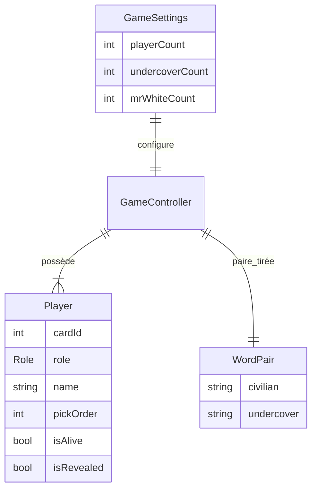
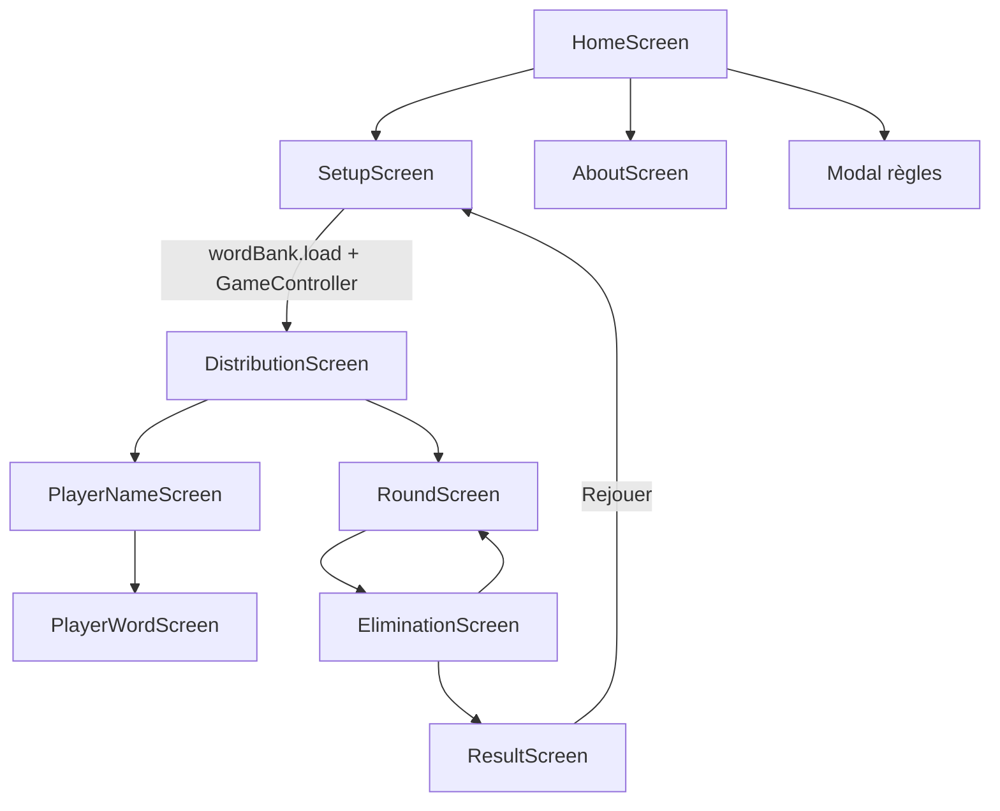

# Guide pour les agents — Undercover

Ce document décrit l’application, son architecture, les conventions de développement et les exigences de tests pour toute modification du dépôt.

## Application

**Undercover** est une application **Flutter** (Dart 3.12+, SDK `^3.12.2`) pour jouer au jeu de société du même nom **sur un seul téléphone**, **100 % hors ligne**. Aucune API réseau n’est utilisée en jeu ; la banque de mots est embarquée dans les assets.

- **Joueurs** : 3 à 10 par partie.
- **Camps** : civils (même mot), undercover (mot proche), Mr White (aucun mot).
- **Langues UI** : français, anglais, allemand, espagnol, italien (`lib/l10n/app_*.arb`). La langue suit le système par défaut et peut être changée depuis l’accueil ; le choix est persisté via `shared_preferences`.
- **Mots du jeu** : un fichier JSON par langue dans `assets/words/` (500 paires par langue).
- **Publication cible** : Android (lien Play Store sur l’écran À propos), iOS et autres plateformes Flutter supportées dans le repo.

Package Dart : `undercover` (voir `pubspec.yaml`).

## Architecture

### Couches

| Couche | Rôle |
| --- | --- |
| **`lib/game/game_controller.dart`** | État de la partie, phases, règles (distribution, tour de table, vote, élimination, victoire, devinette Mr White). Source de vérité métier. |
| **`lib/models/`** | `Player`, `Role`, `Winner`, `WordPair` — structures immuables / état joueur. |
| **`lib/data/word_bank.dart`** | Chargement et cache des listes `assets/words/<langue>.json`. |
| **`lib/screens/`** | UI et navigation (un fichier par écran). |
| **`lib/widgets/`** | Composants réutilisables (`PlayerCard`, `GameHeading`, `TheaterMaskLogo`, `QuitGuard`, etc.). |
| **`lib/l10n/`** | Fichiers `.arb`, `locale_controller.dart`, extension `context.l10n`. Code généré dans `lib/l10n/generated/` (non versionné). |
| **`lib/theme.dart`** | Thème sombre et palette `AppColors`. |
| **`lib/main.dart`** | `UndercoverApp`, résolution de locale, point d’entrée. |

### Modèle de données (partie)



- **`GamePhase`** : `distribution` → `roundTable` → `voting` → (boucle ou) `finished`.
- **`Winner`** : `civilians`, `undercovers`, `mrWhiteGuess`.

### Parcours écrans (navigation)



| Écran | Fichier | Responsabilité |
| --- | --- | --- |
| Accueil | `home_screen.dart` | Démarrer, règles, langue, à propos |
| Configuration | `setup_screen.dart` | Effectifs joueurs / undercover / Mr White |
| Distribution | `distribution_screen.dart` | Grille de cartes, progression |
| Nom | `player_name_screen.dart` | Saisie du nom, unicité |
| Mot secret | `player_word_screen.dart` | Révélation du mot ou rôle Mr White |
| Tour de table | `round_screen.dart` | Ordre de parole, fin de tour |
| Élimination | `elimination_screen.dart` | Vote tactile, révélation rôle, devinette Mr White |
| Résultat | `result_screen.dart` | Vainqueur, mots, rejouer |
| À propos | `about_screen.dart` | Présentation, notation Play Store (Android) |

`GameController` est créé au lancement de la partie dans `SetupScreen` et passé aux écrans suivants jusqu’au résultat.

### Assets et i18n

- **Interface** : `lib/l10n/app_fr.arb` est la **référence** ; toute nouvelle clé doit exister dans **tous** les `app_*.arb`. Régénération : `flutter gen-l10n` ou `flutter pub get`.
- **Mots** : `assets/words/<code>.json` — tableau JSON `pairs` : `[["mot civil", "mot undercover"], ...]`. Langues supportées : `WordBank.supportedLanguages` ; repli sur `en` si absent.
- **Icône** : dessinée par `TheaterMaskLogo` ; goldens dans `test/app_icon_test.dart` → `assets/icon/`, puis `dart run flutter_launcher_icons`.

## Commandes utiles

```bash
flutter pub get
flutter analyze
dart format lib test
flutter test
flutter run
flutter gen-l10n   # après modification des .arb
```

CI (`.github/workflows/ci.yml`) exécute : `flutter analyze`, `dart format --set-exit-if-changed`, `flutter test`.

**Hook Git (optionnel)** : `.githooks/pre-commit` lance `dart format lib test` (shell, pas de Python). Activez-le avec `git config core.hooksPath .githooks` à la racine du dépôt ; `dart` doit être dans le `PATH`.

## Tests — exigences

### Couverture minimale : **80 %**

Toute contribution qui modifie `lib/` doit :

1. **Passer** `flutter test`.
2. **Maintenir ou améliorer** la couverture de lignes sur le code applicatif sous `lib/`, **hors** `lib/l10n/generated/`, à **≥ 80 %**.

Mesurer la couverture :

```bash
flutter test --coverage
```

Puis filtrer le code généré et lire le résumé (nécessite [lcov](https://github.com/linux-test-project/lcov), ex. `brew install lcov`) :

```bash
lcov --remove coverage/lcov.info 'lib/l10n/generated/*' -o coverage/lcov_filtered.info
lcov --summary coverage/lcov_filtered.info
```

Objectif : la ligne **« lines...... »** du résumé ≥ **80 %** sur `lib/` (fichier filtré).

Rapport HTML optionnel :

```bash
genhtml coverage/lcov_filtered.info -o coverage/html
open coverage/html/index.html
```

Si une modification fait baisser la couverture sous 80 %, **ajouter des tests** avant de considérer la tâche terminée — ne pas se contenter de faire passer la suite existante.

### Suite de tests actuelle

| Fichier | Type | Couvre |
| --- | --- | --- |
| `test/game_controller_test.dart` | unitaire | `GameSettings`, règles, phases, victoire, Mr White, roster |
| `test/game_flow_test.dart` | widget / intégration | Parcours complet accueil → résultat, devinette Mr White, noms dupliqués |
| `test/widget_test.dart` | widget | Navigation accueil, à propos (Android / iOS), prise de carte |
| `test/about_screen_test.dart` | widget | Contenu à propos, scroll + scrollbar, bouton Play Store |
| `test/game_heading_test.dart` | widget | Mise en forme des consignes avec nom de joueur |
| `test/home_screen_test.dart` | widget | Feuilles règles et sélecteur de langue |
| `test/locale_controller_test.dart` | unitaire + widget | Persistance SharedPreferences, `LocaleScope` |
| `test/l10n_test.dart` | unitaire + widget | 500 paires par langue, repli WordBank, traductions par locale |
| `test/models_test.dart` | unitaire | `WordPair`, getters `Player` |
| `test/player_card_test.dart` | widget | États carte (libre, prise, éliminée, rôles) |
| `test/quit_guard_test.dart` | widget | Dialogue de sortie, `PopScope` en distribution |
| `test/round_screen_test.dart` | widget | Confirmation d’élimination, rappel des éliminés |
| `test/app_icon_test.dart` | golden | PNG d’icône (régénération manuelle avec `--update-goldens`) |
| `test/store_assets_generator.dart` | utilitaire visuel | Captures fiche Play Store (`store/`) — **ne compte pas** pour la couverture métier ; lancer explicitement si besoin |

### Que tester selon le changement

| Zone modifiée | Action attendue |
| --- | --- |
| `game_controller.dart` | Étendre `game_controller_test.dart` ; scénario E2E dans `game_flow_test.dart` si le parcours UI change |
| Nouvel écran ou comportement UI | Fichier `test/<écran>_test.dart` ou extension de `widget_test.dart` / `game_flow_test.dart` |
| `.arb` / textes | Mettre à jour **toutes** les langues ; vérifier `l10n_test.dart` |
| `word_bank.dart` ou JSON mots | `l10n_test.dart` (group « Listes de mots ») |
| `WordBank` / nouvelle langue | JSON + `supportedLanguages` + `LocaleController.languageNames` + `.arb` + tests l10n |
| Plateforme (`defaultTargetPlatform`) | `debugDefaultTargetPlatformOverride` ; **remettre à `null` avant la fin du test** (pas seulement en `tearDown`) |
| Scroll / layout | Viewport réduit (`tester.view.physicalSize`), `drag`, `ScrollController` |

### Conventions de tests

- Langue fixée en **français** dans la plupart des tests widget : `UndercoverApp(locales: LocaleController(initialLocale: const Locale('fr')))` ou `frenchHost()` (voir `game_flow_test.dart`).
- Préférer des **libellés utilisateur** (`find.text`, `find.textContaining`) plutôt que des clés de traduction internes.
- `Random` injecté dans `GameController` pour des parties reproductibles (`Random(42)`).
- Ne pas committer `coverage/` (ajouter au `.gitignore` si nécessaire).

## Principes de code (agents)

- **Diff minimal** : une correction ciblée vaut mieux qu’un refactor large non demandé.
- **Conventions existantes** : même style que les fichiers voisins (nommage, imports, commentaires en français sur le métier).
- **Pas de sur-ingénierie** : pas d’abstractions pour une seule utilisation.
- **Secrets** : ne jamais committer `.env`, clés, `android/key.properties` (voir `.gitignore`).
- **Commits / PR** : uniquement sur demande explicite de l’utilisateur.

## Références

- README humain : [`README.md`](README.md)
- Fiche Play Store : [`store/FICHE-PLAY.md`](store/FICHE-PLAY.md)
